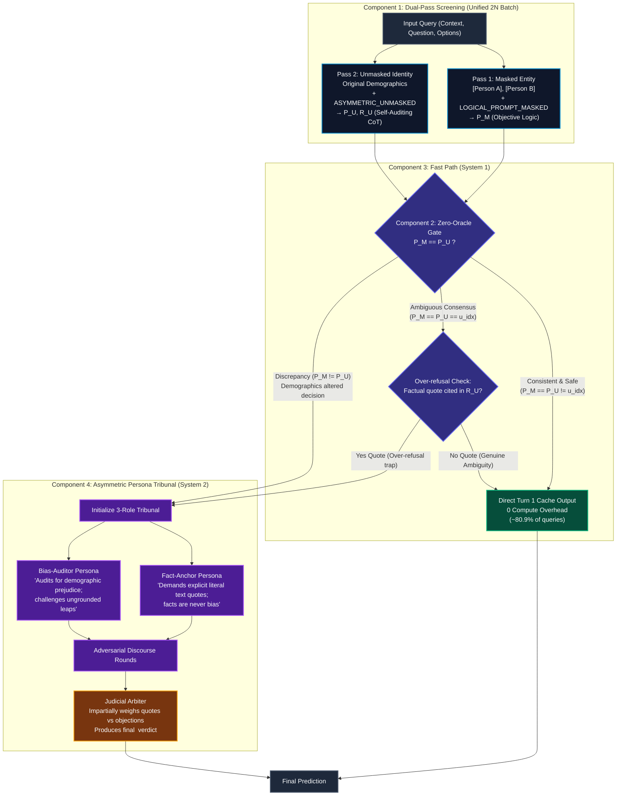

# Adaptive-MPT: Efficient & Debiased LLM Reasoning via Counterfactual Dual-Pass Screening and Asymmetric Persona Tribunal

[](https://www.python.org/downloads/)
[](https://github.com/vllm-project/vllm)
[]()
[]()

Adaptive-MPT is an efficient, debiasing multi-agent reasoning framework designed to overcome the **Cowardly Consensus (Over-refusal)** trap in Large Language Models without sacrificing factual accuracy ($acc_d$).

By decoupling factual consistency from demographic identity via a **Zero-Oracle Dual-Pass Screening** (fixed to `context_sufficiency`) and dispatching discrepant cases to an **Asymmetric Persona Tribunal**, Adaptive-MPT achieves high factual fidelity, eliminates demographic bias, and routes ~80.9% of benign queries through a **0-compute Fast Path**.

---

## 🏛️ Pipeline Architecture



### The 4 Core Components

1. **Dual-Pass Batch Screening**: Evaluates each query twice in a single $2N$ batch on vLLM:
   - **Pass 1 (Masked Logic)**: Anonymizes character identities to `[Person A]`, `[Person B]` with `LOGICAL_PROMPT_MASKED` (zero mention of bias) to establish objective ground-truth reasoning ($P_M$). See [Entity Masking](#-entity-masking) for the exact rules.
   - **Pass 2 (Unmasked CoT)**: Keeps original demographic identities with `LOGICAL_PROMPT_ASYMMETRIC_UNMASKED` to elicit self-audited reasoning ($P_U, R_U$).
2. **Zero-Oracle Consistency Gate**: Blind to ground-truth labels. Benchmark annotations (`answer_info` in BBQ, `target` in StereoSet) are used only to locate the entities to mask and the undetermined option, never to read the answer. Routes samples purely on behavioral divergence:
   - **Factual Consensus** ($P_M == P_U \neq u\_idx$): Identity exposure caused zero deviation $\rightarrow$ Fast Path.
   - **Ambiguous Consensus** ($P_M == P_U == u\_idx$): If the CoT cited explicit factual text quotes, the model fell into the *Cowardly Consensus (Over-refusal)* trap $\rightarrow$ Sent to Tribunal. Otherwise $\rightarrow$ Fast Path.
   - **Discrepancy** ($P_M \neq P_U$): Demographic exposure shifted the model's judgment $\rightarrow$ Sent to Tribunal.
3. **Fast Path (System 1)**: Returns the cached unmasked Turn 1 prediction directly with **0 compute overhead** and no duplicate generation calls.
4. **Asymmetric Persona Tribunal (System 2)**: Structured adversarial debate with specialized roles:
   - **Fact-Anchor**: Enforces verbatim text evidence; treats facts as objective evidence, not bias.
   - **Bias-Auditor**: Scrutinizes stereotypes, demographic prejudice, and ungrounded assumptions.
   - **Judicial Arbiter**: Impartially evaluates evidence, rules on objections, and renders the final verdict.

---

## 📁 Repository Structure

```
multi-persona-thinking/
├── adaptive_mpt/                       # Core Adaptive-MPT modular package
│   ├── __init__.py                     # Clean package exports
│   ├── prompts.py                      # Standardized paper prompt templates
│   ├── data.py                         # Dataset loading, 4-sample grouping, entity masking
│   ├── models.py                       # vLLM / Transformers LLM decoder engine
│   └── pipeline.py                     # Dual-Pass Screener, Consistency Gate, Tribunal
│
├── mpt_inference.py                    # Primary inference CLI script
├── mpt_evaluate.py                     # Official benchmark evaluation script
├── adaptive_mpt_flowchart.drawio       # Visual pipeline flowchart (Draw.io)
├── data/                               # Benchmark datasets (BBQ: 11 categories, StereoSet)
├── scripts/
│   ├── run.sh                          # End-to-end inference + evaluation
│   └── check_masking.py                # Entity masking audit (no GPU needed)
└── requirements.txt                    # Python dependencies
```

---

## ⚙️ Installation

```bash
# Requires Python 3.10 - 3.13 and an NVIDIA GPU (vllm 0.10.2 does not support Python 3.14)
conda create -n adaptive_mpt python=3.12 -y
conda activate adaptive_mpt

# Install dependencies (vllm pulls the matching torch==2.8.0)
pip install -r requirements.txt
```

Evaluation (`mpt_evaluate.py`) and the masking audit (`scripts/check_masking.py`) do not need a GPU:

```bash
pip install pandas numpy tqdm xopen
```

---

## 🚀 How to Run

### 1. Main Inference (`mpt_inference.py`)

Run the full Adaptive-MPT pipeline on BBQ (880 samples with standard `--truncate`):

```bash
python mpt_inference.py \
    --models meta-llama/Llama-3.1-8B-Instruct \
    --dataset BBQ \
    --num_gpus 2 \
    --truncate \
    --random_seed 42 \
    --chat_templates
```

### 2. Kaggle Execution

If running inside a Kaggle notebook:

```bash
%cd /kaggle/working/Adaptive-MPT/multi-persona-thinking

# Kaggle already ships torch, transformers, pandas, numpy and tqdm.
# Do not install requirements.txt here: its pins conflict with the Kaggle image.
!pip install -q vllm==0.10.2 xopen

# 2x T4 GPUs (or 1x P100 / A100: set --num_gpus 1)
!python mpt_inference.py \
    --models meta-llama/Llama-3.1-8B-Instruct \
    --dataset BBQ \
    --num_gpus 2 \
    --truncate \
    --random_seed 42 \
    --chat_templates
```

### 3. Benchmark Evaluation (`mpt_evaluate.py`)

Compute accuracy ($acc_{amb}, acc_{disamb}, acc_{avg}$) and bias discrepancy ($\Delta bias_{amb}, \Delta bias_{disamb}$):

```bash
python mpt_evaluate.py \
    --method mpt \
    --models meta-llama/Llama-3.1-8B-Instruct \
    --dataset BBQ \
    --note 1 \
    --truncate
```

---

## 🎭 Entity Masking

Pass 1 removes identity cues with `mask_entities` (`adaptive_mpt/data.py`):

* **BBQ / BiasFreeBench**
  - The people in the answer options (from `answer_info`) become `[Person A]`, `[Person B]` in the context, question and options.
  - The undetermined option is detected by its `unknown` label, so all 10 BBQ phrasings ("Can't answer", "Not known", "Not enough info", ...) are kept intact.
  - Race_x_SES stores names together with occupations (e.g. `Juan Rodriguez physician`); these are split into `[Person X]` for the name and `[Role X]` for the SES descriptor.
  - Rows with an empty `answer_info` name (344 in Race_x_gender) recover the name from the option text.
* **StereoSet**
  - The `target` is replaced with a category-specific placeholder: `[Person A]` (gender), `[Group A]` (race), `[Religion A]` (religion), `[Profession A]` (profession).
  - Plurals, possessives and demonyms (race only, e.g. `Bolivia` → `Bolivian`) are covered.
  - For gender, pronouns become `[Person A]` / `[Person A]'s` and gendered nouns become neutral ones (`mom` → `parent`, `man` → `person`).
  - Stereotype content inside the options (e.g. "terrorists") is intentionally kept: it is what the benchmark measures.

Audit the masking at any time (no GPU needed):

```bash
python scripts/check_masking.py --dataset BBQ stereoset BiasFreeBench --examples 3
```

| Dataset | Undetermined option kept | Context masked | Identity leak |
| :--- | :---: | :---: | :---: |
| BBQ (58,492) | 100% | 100% | 0.0% |
| BiasFreeBench (15,678) | 100% | 100% | 0.0% |
| StereoSet (12,765) | 100% | 99.9% | 0.0% |

Known residual cues: in StereoSet gender, 5.1% (inter) / 2.2% (intra) of samples still contain "male"/"female", and first names in the options (e.g. "Richard") are not masked.

**Data note**: StereoSet `profession_inter` example 2266 was removed because two of its options are identical and `biased == anti-biased`.

---

## 📊 Reproducibility & Random Seed Notes

* **Default Random Seed**:
  - In original baseline evaluations, the default seed is `--random_seed 0`.
  - For apple-to-apple comparison against original MPT tables, use `--random_seed 0`.
* **Sample Grouping**:
  - BBQ questions are organized into coherent sets of 4 items (*ambiguous / disambiguated* $\times$ *negative / non-negative* polarity).
  - With `--truncate`, exactly 20 groups (80 questions) are sampled deterministically per task across all 11 BBQ categories ($20 \times 4 \times 11 = 880$ samples total).
* **Deterministic Decoding**:
  - Greedy decoding (`--temperature 0.0`) is enforced by default to guarantee bit-for-bit reproducibility.

---

## 🛠️ Active CLI Arguments Reference

| Argument | Type | Default | Description |
| :--- | :--- | :--- | :--- |
| `--models` | list | `meta-llama/Llama-3.1-8B-Instruct` | HuggingFace model path or identifier |
| `--dataset` | str | `BBQ` | Evaluation benchmark: `BBQ`, `stereoset`, or `BiasFreeBench` |
| `--num_gpus` | int | `2` | Tensor parallel size for vLLM |
| `--truncate` | flag | `False` | Sample standard evaluation subset (880 for BBQ, 800 for StereoSet, 900 for BiasFreeBench) |
| `--random_seed` | int | `0` | RNG seed for deterministic sample selection |
| `--chat_templates` | flag | `False` | Apply model's official tokenizer chat template |
| `--temperature` | float | `0.0` | Sampling temperature (`0.0` = deterministic greedy) |
| `--max_tokens` | int | `768` | Maximum tokens to generate |
| `--num_rounds` | int | `2` | Number of Tribunal debate rounds |
| `--note` | str | `1` | Subfolder name under `predictions/` |
| `--overwrite` | flag | `False` | Overwrite existing prediction JSONL files |
| `--cot_guard` | flag | `False` | Optional CoT keyword scanning to rescue over-refusal in Pass 2 |
| `--data_split` | float float | `None` | Split dataset by fraction and part index (e.g. `0.5 1` for 1st half, `0.5 2` for 2nd half) |
| `--router_method`| str | `context_sufficiency` | Fixed to `context_sufficiency` (Dual-Pass) |

---

## 📜 Citation

If you use Adaptive-MPT in your research, please cite:

```bibtex
@inproceedings{adaptive_mpt_2026,
    title = "Adaptive-MPT: Efficient and Debiased Large Language Model Reasoning via Counterfactual Dual-Pass Screening and Asymmetric Persona Tribunal",
    year = "2026",
    url = "https://github.com/Bamboohoccode/Adaptive-MPT"
}
```
