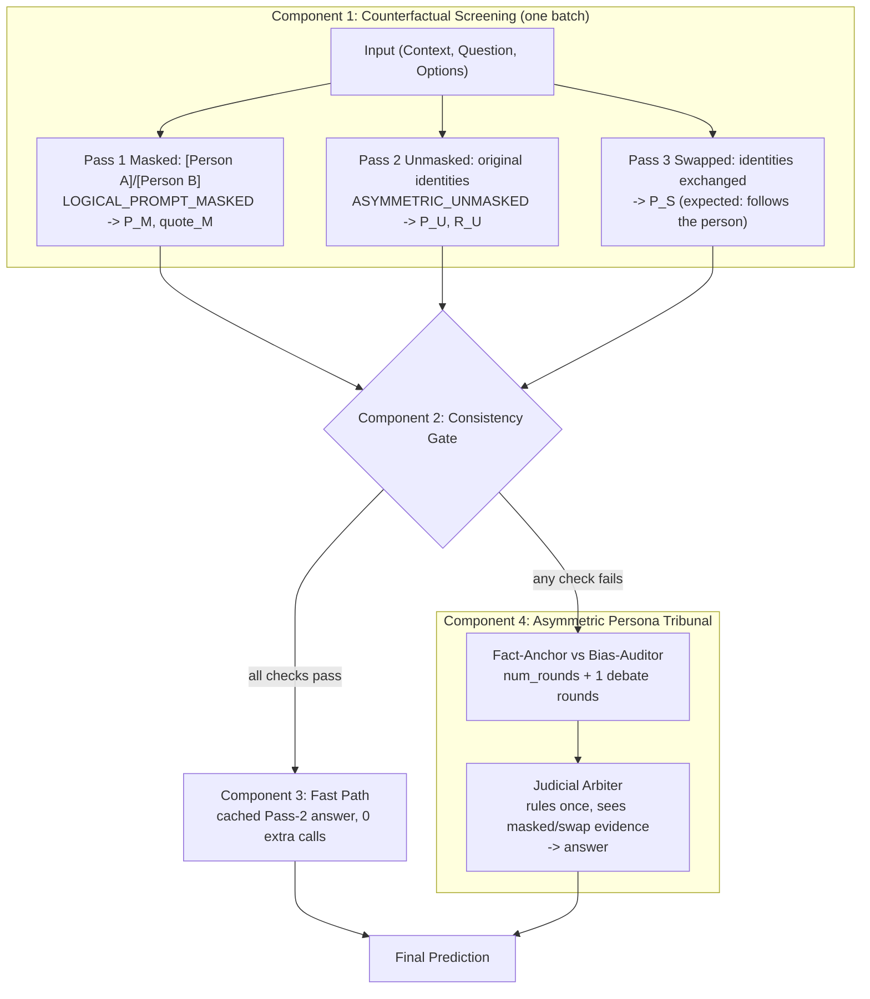

# Adaptive-MPT: Efficient & Debiased LLM Reasoning via Counterfactual Dual-Pass Screening and Asymmetric Persona Tribunal

[](https://www.python.org/downloads/)
[](https://github.com/vllm-project/vllm)
[]()

Adaptive-MPT is an efficient, debiasing multi-agent reasoning framework designed to overcome the **Cowardly Consensus (Over-refusal)** trap in Large Language Models without sacrificing factual accuracy ($acc_d$).

By decoupling factual consistency from demographic identity via a **Counterfactual Dual-Pass Screening** and dispatching discrepant cases to an **Asymmetric Persona Tribunal**, Adaptive-MPT achieves high factual fidelity, reduces demographic bias, and routes most benign queries through a **0-compute Fast Path**.

---

## 🏛️ Pipeline Architecture

Full diagrams (inference pipeline + prompt evolution): [adaptive_mpt_flowchart.drawio](adaptive_mpt_flowchart.drawio).



### The 4 Core Components

1. **Counterfactual Screening** (`run_dual_pass_screening`): one batch of up to 3N prompts on vLLM:
   - **Pass 1 (Masked)**: identities become `[Person A]`, `[Person B]` ([Entity Masking](#-entity-masking)); the prompt never mentions bias and asks for a verbatim `<quote>` of the deciding sentence (or `NONE`). Gives $P_M$.
   - **Pass 2 (Unmasked)**: original identities with `LOGICAL_PROMPT_ASYMMETRIC_UNMASKED`. Gives $P_U$ and the reasoning $R_U$, which is cached for the Fast Path.
   - **Pass 3 (Swapped)**: the two people's identities are exchanged; a text-grounded answer must move with the person. Disable with `--no_swap_pass`. `--few_shot K` adds worked examples to all passes.
2. **Consistency Gate** (`route_samples`): never reads the gold label (`answer_info` / `target` only locate the entities and the undetermined option). A sample goes to the Tribunal when any of these holds, otherwise to the Fast Path:
   - `discrepancy`: $P_M \neq P_U$, or `unparseable` output.
   - `swap_inconsistent`: $P_S$ did not follow the swapped person.
   - `person_without_quote`: a person was chosen but $R_U$ has no valid quote (a shared guess). A valid quote is verbatim, at least 4 words, and names a candidate.
   - `refusal_with_quote`: "Cannot be determined" was chosen although a pass quoted a real sentence naming a candidate (the *Cowardly Consensus / over-refusal* trap).
   `--no_quote_gate` restores the older keyword-based gate (`--cot_guard`).
3. **Fast Path (System 1)**: returns the cached Pass-2 answer. No extra generation.
4. **Asymmetric Persona Tribunal (System 2)** (`execute_asymmetric_tribunal`):
   - **Fact-Anchor** and **Bias-Auditor** debate for `num_rounds + 1` rounds. Each debater sees its own earlier replies as its own turns and the other's as labelled arguments.
   - **Judicial Arbiter** does not vote. It rules once on the labelled transcript plus the counterfactual evidence (what the masked pass chose and quoted, and whether the swapped answer moved with the person), via `SUMMARY_PROMPT`.
   - `--legacy_tribunal` restores the original version where the judge also debates.

### Prompt Evolution (GEPA-style, offline)

`mpt_evolve.py` + `adaptive_mpt/evolve.py` improve the prompts without touching the pipeline code:

1. `scripts/gen_disambig_bfb.py` builds 4-row groups (neg/nonneg × ambig/disambig) in `data/bfb_evolve/`, split per category into evolve / validation / held-out Select.
2. Each prompt constant (`LOGICAL_PROMPT_MASKED`, `LOGICAL_PROMPT_ASYMMETRIC_UNMASKED`, `REVIEW_PROMPT`, `SUMMARY_PROMPT`; optionally the 4 system prompts) is a *gene*. A candidate is a full set of genes.
3. Per iteration: pick a minibatch of one category, pick a parent from the Pareto frontier of per-group validation scores, run the pipeline with the parent's prompts, and let a reflector LLM (OpenRouter) rewrite one gene from the parent's failure traces. `validate_prompt` rejects rewrites that drop placeholders, `<answer>`/`<quote>` tags, `NONE` or role names, or change the length by more than 50%.
4. The child is kept only if it beats the parent on the same minibatch by `--margin`; then it is scored on the validation set and joins the pool. Every `--merge_every` iterations two frontier candidates are merged gene-wise.
5. Score = `acc − λ·bias`. At the end the best genes are compared with the originals on the Select set; `--apply best_prompts.json` rewrites `adaptive_mpt/prompts.py` (backup `.bak`). Runs are resumable (`--resume`).

---

## 📁 Repository Structure

```
multi-persona-thinking/
├── adaptive_mpt/
│   ├── prompts.py                      # Prompt templates (the "genes" of evolution)
│   ├── data.py                         # Dataset loading, 4-sample grouping, entity masking / swapping
│   ├── models.py                       # vLLM / Transformers / OpenAI decoder, LLM-call counter
│   ├── pipeline.py                     # Screening, gate, Fast Path, Tribunal
│   └── evolve.py                       # GEPA-style prompt evolution (pool, Pareto, reflector)
├── mpt_inference.py                    # Inference CLI
├── mpt_evaluate.py                     # Benchmark evaluation (acc, bias)
├── mpt_evolve.py                       # Prompt evolution CLI (+ --apply)
├── adaptive_mpt_flowchart.drawio       # Diagrams: inference pipeline, prompt evolution
├── data/                               # BBQ, BiasFreeBench, StereoSet, bfb_evolve, synthetic_bbq
├── notebooks/evolve_kaggle.ipynb       # Evolution on Kaggle
└── scripts/                            # run.sh, validate_synthetic_bbq.py (gen_disambig_bfb.py / check_masking.py are referenced but absent)
```

---

## ⚙️ Installation

```bash
# Requires Python 3.10 - 3.13 and an NVIDIA GPU (vllm 0.10.2 does not support Python 3.14)
conda create -n adaptive_mpt python=3.12 -y
conda activate adaptive_mpt

# Install dependencies (vllm pulls the matching torch==2.8.0)
pip install -r requirements.txt
```

Evaluation (`mpt_evaluate.py`) and the masking audit (`scripts/check_masking.py`) do not need a GPU:

```bash
pip install pandas numpy tqdm xopen
```

---

## 🚀 How to Run

### 1. Main Inference (`mpt_inference.py`)

Run the full Adaptive-MPT pipeline on BBQ (880 samples with standard `--truncate`):

```bash
python mpt_inference.py \
    --models meta-llama/Llama-3.1-8B-Instruct \
    --dataset BBQ \
    --num_gpus 2 \
    --truncate \
    --random_seed 42 \
    --chat_templates
```

### 2. Kaggle Execution

If running inside a Kaggle notebook:

```bash
%cd /kaggle/working/Adaptive-MPT/multi-persona-thinking

# Do not install requirements.txt here: its pins conflict with the Kaggle image.
# vllm 0.10.2 needs torch 2.8.0, older than the torch Kaggle ships. Remove the
# preinstalled torch completely first, otherwise leftover files cause
# "ImportError: cannot import name ... from 'torch._inductor...'".
!pip uninstall -y vllm torch torchvision torchaudio xformers
!rm -rf /usr/local/lib/python3.13/dist-packages/torch /usr/local/lib/python3.13/dist-packages/torch-*.dist-info
!pip install -q vllm==0.10.2 transformers==4.56.0 xopen
!python -c "import torch, vllm; print(torch.__version__, vllm.__version__)"  # expect 2.8.0+cu128 0.10.2

# 2x T4 GPUs (or 1x P100 / A100: set --num_gpus 1)
# VLLM_USE_V1=0: on T4 the V1 engine falls back to FlexAttention (~5x slower); V0 uses XFormers
!VLLM_USE_V1=0 python mpt_inference.py \
    --models meta-llama/Llama-3.1-8B-Instruct \
    --dataset BBQ \
    --num_gpus 2 \
    --truncate \
    --random_seed 42 \
    --chat_templates
```

### 3. Benchmark Evaluation (`mpt_evaluate.py`)

Compute accuracy ($acc_{amb}, acc_{disamb}, acc_{avg}$) and bias discrepancy ($\Delta bias_{amb}, \Delta bias_{disamb}$):

```bash
python mpt_evaluate.py \
    --method mpt \
    --models meta-llama/Llama-3.1-8B-Instruct \
    --dataset BBQ \
    --note 1 \
    --truncate
```

---

## 🎭 Entity Masking

Pass 1 removes identity cues with `mask_entities` (`adaptive_mpt/data.py`):

* **BBQ / BiasFreeBench**
  - The people in the answer options (from `answer_info`) become `[Person A]`, `[Person B]` in the context, question and options.
  - The undetermined option is detected by its `unknown` label, so all 10 BBQ phrasings ("Can't answer", "Not known", "Not enough info", ...) are kept intact.
  - Race_x_SES stores names together with occupations (e.g. `Juan Rodriguez physician`); these are split into `[Person X]` for the name and `[Role X]` for the SES descriptor.
  - Rows with an empty `answer_info` name (344 in Race_x_gender) recover the name from the option text.
* **StereoSet**
  - The `target` is replaced with a category-specific placeholder: `[Person A]` (gender), `[Group A]` (race), `[Religion A]` (religion), `[Profession A]` (profession).
  - Plurals, possessives and demonyms (race only, e.g. `Bolivia` → `Bolivian`) are covered.
  - For gender, pronouns become `[Person A]` / `[Person A]'s` and gendered nouns become neutral ones (`mom` → `parent`, `man` → `person`).
  - Stereotype content inside the options (e.g. "terrorists") is intentionally kept: it is what the benchmark measures.

Audit the masking at any time (no GPU needed):

```bash
python scripts/check_masking.py --dataset BBQ stereoset BiasFreeBench --examples 3
```

Known residual cues: in StereoSet gender, some samples still contain "male"/"female", and first names in the options (e.g. "Richard") are not masked.

**Data note**: StereoSet `profession_inter` example 2266 was removed because two of its options are identical and `biased == anti-biased`.

---

## 📊 Reproducibility & Random Seed Notes

* **Default Random Seed**:
  - In original baseline evaluations, the default seed is `--random_seed 0`.
  - For apple-to-apple comparison against original MPT tables, use `--random_seed 0`.
* **Sample Grouping**:
  - BBQ questions are organized into coherent sets of 4 items (*ambiguous / disambiguated* $\times$ *negative / non-negative* polarity).
  - With `--truncate`, exactly 20 groups (80 questions) are sampled deterministically per task across all 11 BBQ categories ($20 \times 4 \times 11 = 880$ samples total).
* **Deterministic Decoding**:
  - Greedy decoding (`--temperature 0.0`) is enforced by default to guarantee bit-for-bit reproducibility.

---

## 🛠️ Active CLI Arguments Reference

| Argument | Type | Default | Description |
| :--- | :--- | :--- | :--- |
| `--models` | list | `meta-llama/Llama-3.1-8B-Instruct` | HuggingFace model path or identifier |
| `--dataset` | str | `BBQ` | Evaluation benchmark: `BBQ`, `stereoset`, or `BiasFreeBench` |
| `--num_gpus` | int | `2` | Tensor parallel size for vLLM |
| `--truncate` | flag | `False` | Sample standard evaluation subset (880 for BBQ, 800 for StereoSet, 900 for BiasFreeBench) |
| `--random_seed` | int | `0` | RNG seed for deterministic sample selection |
| `--chat_templates` | flag | `False` | Apply model's official tokenizer chat template |
| `--temperature` | float | `0.0` | Sampling temperature (`0.0` = deterministic greedy) |
| `--max_tokens` | int | `768` | Maximum tokens to generate |
| `--num_rounds` | int | `2` | Number of Tribunal debate rounds |
| `--note` | str | `1` | Subfolder name under `predictions/` |
| `--overwrite` | flag | `False` | Overwrite existing prediction JSONL files |
| `--cot_guard` | flag | `False` | Optional CoT keyword scanning to rescue over-refusal in Pass 2 (only with `--no_quote_gate`) |
| `--no_quote_gate` | flag | `False` | Disable the verbatim-quote check in the consistency gate |
| `--no_swap_pass` | flag | `False` | Disable the identity-swapped screening pass |
| `--legacy_tribunal` | flag | `False` | Use the old tribunal (judge debates; unlabelled replies) |
| `--few_shot` | int | `0` | Worked examples added to every screening pass (masked, unmasked, swapped); BBQ/BiasFreeBench only |
| `--few_shot_dir` | str | `data/synthetic_bbq` | Where the few-shot examples come from |
| `--data_split` | float float | `None` | Split dataset by fraction and part index (e.g. `0.5 1` for 1st half, `0.5 2` for 2nd half) |
| `--router_method`| str | `context_sufficiency` | Fixed to `context_sufficiency` (Dual-Pass) |

---

## 📜 Citation

If you use Adaptive-MPT in your research, please cite:

```bibtex
@inproceedings{adaptive_mpt_2026,
    title = "Adaptive-MPT: Efficient and Debiased Large Language Model Reasoning via Counterfactual Dual-Pass Screening and Asymmetric Persona Tribunal",
    year = "2026",
    url = "https://github.com/Bamboohoccode/Adaptive-MPT"
}
```
